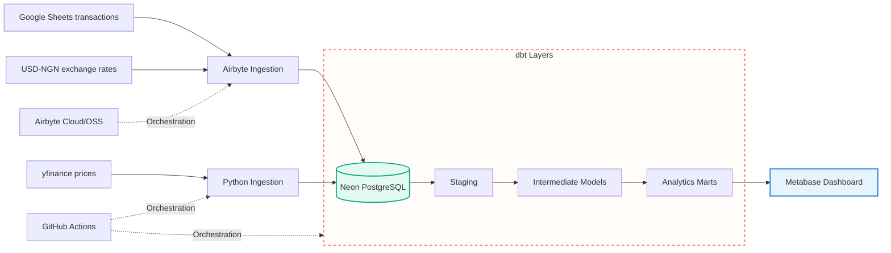

# PortfolioPulse
### A Global Investment Analytics Platform | Datafrik Capstone

PortfolioPulse is an end-to-end investment analytics project that brings stock transaction history, historical market prices, and USD–NGN exchange rates into a unified workflow to answer:
*What is my investment portfolio worth in USD and Nigerian Naira over time , and how has its market value changed over time?*

The platform integrates transaction records from Google Sheets, market prices from yfinance, and exchange-rate data into Neon PostgreSQL. Airbyte and custom Python ingestion code handle data collection, dbt Core standardizes and transforms the data into analytics-ready models, GitHub Actions automates configured workflows, and Metabase presents portfolio performance through an interactive dashboard.


> **Project note:** This is a capstone analytics project, not investment advice or a live brokerage statement. Identify any simulated transaction data as simulated.

## Dashboard preview

<div align="center">
    
</div>

The dashboard currently presents portfolio value in USD and NGN, historical market-value trend, position-level gain/loss, ticker allocation, daily movement, unrealized ROI, and top stock by ROI.

## Architecture




### Architecture Overview

PortfolioPulse follows a layered data architecture:

1. **Data sources:** Google Sheets provides transaction records, Yahoo Finance provides stock-price history, and the configured exchange-rate provider supplies USD–NGN rates.
2. **Ingestion:** Airbyte synchronizes its configured sources, while a Python ingestion script retrieves and loads stock-price data.
3. **Raw storage:** Neon PostgreSQL stores ingested data before analytical transformations.
4. **Transformation and testing:** dbt Core organizes data into staging, intermediate, and mart models and runs the configured data-quality tests.
5. **Orchestration:** GitHub Actions automates the configured Python and dbt workflows. Airbyte scheduling manages the synchronization jobs assigned to Airbyte.
6. **Visualization:** Metabase connects to the analytical data and presents portfolio valuation and performance metrics.

GitHub Actions is the orchestration layer rather than a separate data-processing layer. Each component has a defined responsibility, making the pipeline easier to troubleshoot and extend.


## Technology Stack

| Area | Technology |
|---|---|
| Transaction source | Google Sheets |
| Market-price source | yfinance |
| Exchange-rate source | USD–NGN exchange-rate API |
| Ingestion | Airbyte and Python |
| Database | Neon PostgreSQL |
| Transformation and testing | dbt Core |
| Workflow automation | GitHub Actions and Airbyte scheduling |
| Dashboard | Metabase |
| Local deployment | Docker |


## Data Model and Grain

The dbt project separates source-level records from reusable analytical models and dashboard-ready outputs.

| Model | Intended grain | Purpose |
|---|---|---|
| `stg_stock_transactions` | One row per transaction | Standardizes stock transaction records |
| `stg_yfinance_prices` | One row per ticker and market date | Standardizes historical market prices |
| `stg_exchange_rates` | One row per source rate record | Standardizes exchange-rate data |
| `int_transaction_summary` | One row per ticker | Summarizes purchases, sales, and remaining holdings |
| `mart_portfolio_value_over_time` | One row per valuation date | Calculates historical portfolio market value |
| `mart_profit_loss` | One row per ticker | Reports position-level valuation and profit or loss |
| `mart_daily_portfolio` | One row per valuation date | Provides the daily comparison metrics used by the dashboard |
| `mart_current_portfolio_value` | One portfolio-level row | Reports the latest portfolio valuation in USD and NGN |


Current tracked tickers: `AAPL`, `MSFT`, `AMZN`, `GOOGL`, `JPM`, `JNJ`, `XOM`, and `WMT`.
<div align="center">
    
</div>

## Data Quality and Standardization

Data quality is addressed during the dbt staging and testing process.

### Standardization

The staging models are designed to:

- Trim unnecessary whitespace from text fields.
- Normalize ticker symbols to uppercase.
- Standardize transaction-type capitalization.
- Convert date and numeric fields into appropriate data types.
- Rename source columns to consistent analytical names.
- Retain supported transaction types, such as buys and sells.

### Testing

The project uses selected dbt schema tests, including uniqueness and not-null checks, on key identifiers and required fields. These tests help identify duplicate keys and missing values in the tested models.

Passing these tests does not, by itself, guarantee financial accuracy. Additional checks are needed to verify transaction validity, price coverage, holdings calculations, exchange-rate selection, and the consistency of portfolio totals.

### Important validation checks

- Transaction identifiers are unique and required fields are populated.
- Transaction types are normalized before buy/sell filtering.
- Shares, prices, and exchange rates satisfy the expected business rules.
- Stock prices have a unique key at the intended ticker/date grain.
- Historical valuations use holdings and market prices aligned to the same valuation date.
- Portfolio-level values reconcile to the sum of individual position values.
- ROI calculations use the intended cost-basis denominator.
- Exchange rates are selected using the appropriate effective date.


See [data-quality documentation](/docs/data_quality.md) for the detailed checks and calculation considerations.

## Metric definitions

The merics and business logic for this project is defined here [Business Logic](/docs/Business_logic.md)


## Getting Started

### Prerequisites

Before running PortfolioPulse, prepare:

- Python and the packages listed in `requirements.txt`, if provided.
- Access to the Neon PostgreSQL database and the required database permissions.
- dbt Core with the PostgreSQL adapter.
- Source credentials for the configured data providers.
- Access to the Google Sheet and any external services required by the ingestion workflows.
- Metabase access if you want to view the dashboard.

### Setup

1. Clone the repository and create a Python virtual environment.
2. Install the Python dependencies documented by the project.
3. Configure the required database and source credentials using environment variables or the appropriate local configuration files.
4. Configure dbt's local profile to connect to the intended Neon database.
5. Test the database connection and resolve any missing package or credential issues.
6. Run the relevant ingestion workflow to populate the required raw data.
7. Run the dbt commands below to install configured dbt packages, build models, and execute the tests included in the build.

```bash
dbt debug
dbt deps
dbt build
```

`dbt build` builds and tests the dbt resources included in the command and project configuration. It does not automatically run the Python ingestion scripts or trigger Airbyte synchronization unless those tasks are explicitly integrated into the workflow.

### Dependency documentation

Use `requirements.txt` for Python package dependencies, `packages.yml` for dbt packages when applicable, and `dbt_project.yml` for dbt project configuration. Keep local credentials in the appropriate private configuration or environment variables.

Do not commit database passwords, API keys, service tokens, or credential-bearing configuration files to GitHub. Document required environment-variable names and setup steps without publishing their values.


## Security and Data Access

Database credentials, API keys, and service tokens must be stored securely and excluded from version control. GitHub Actions workflows should retrieve required secrets from the repository or environment secrets configuration rather than hardcoding them in scripts.

If database access is provided for demonstration or assessment, use a dedicated read-only account with access limited to the required schemas and tables. Share connection details privately with authorized reviewers; do not publish passwords or unrestricted database credentials in the README, screenshots, or public documents.

Any sample transaction data should be clearly identified as simulated or anonymized where applicable.

## Project Deliverables

1. GitHub repo 
2. [Google Drive folder](https://drive.google.com/file/d/1qhYx-EfkAZowrs3brlQP6zmvMHizEZ33/view?usp=drive_link) consisting of the following:
    - ER diagram
    - Design decisions
    - Dashboard screenshots
3. A 3-5mins short video  explaining the project uploaded to drive
4. A read only credential for the database.


## Limitations and Assumptions

- **Market-price coverage:** Historical price availability depends on the data source. Missing, delayed, or revised records may affect valuations.
- **Exchange-rate coverage:** USD–NGN valuations depend on the selected provider, the rate's effective date, and the availability of the required rate.
- **Date alignment:** Stock-market trading dates and exchange-rate dates may differ. The rate-selection policy should be documented.
- **Transaction completeness:** Portfolio calculations depend on the completeness and correctness of the transaction history, including buys and sells.
- **Cost-basis assumptions:** Unrealized performance depends on the cost-basis method used by the analytical models.
- **Refresh timing:** Dashboard freshness depends on source synchronization, ingestion completion, scheduled workflow execution, and downstream dbt transformations. A scheduled run does not guarantee that the dashboard updates at an exact time.
- **Scope:** The platform is designed for analytics and demonstration purposes. It is not a brokerage system, tax calculator, or investment-advice service.

These constraints should be considered when interpreting portfolio valuations and performance metrics.


## Future Improvements

- **Dynamic ticker discovery and price ingestion:** Derive the list of tickers from the transaction data and use it to drive price ingestion, reducing dependence on a hardcoded ticker list.
- **Realized gains and losses:** Introduce a dedicated model that calculates realized profit or loss on sold shares using a documented cost-basis method, such as FIFO or weighted-average cost.
- **Foreign-exchange impact analysis:** Separate changes attributable to stock-market performance from changes attributable to USD–NGN exchange-rate movements. This would help explain how currency movements affect the NGN-denominated value of foreign-equity holdings.

These enhancements are proposed extensions of the current platform and should not be interpreted as existing functionality.

## Author

**Isaac Uko Inyang** · Data Engineering & Analytics

- GitHub: [Isaac-Inyang](https://github.com/Isaac-Inyang)
- LinkedIn: [Isaac Uko Inyang](https://www.linkedin.com/in/isaacukoinyang/)

*Built as a Datafrik capstone project.*

