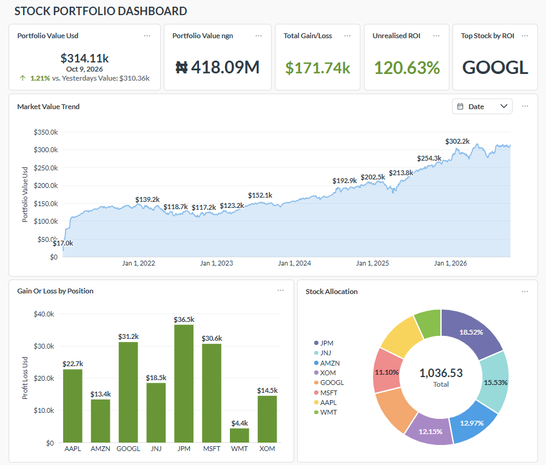
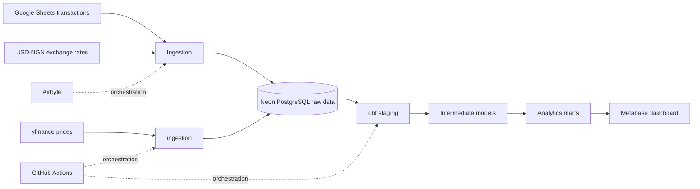

# PortfolioPulse
### A Global Investment Analytics Platform | Datafrik Capstone

**PortfolioPulse brings stock transactions, historical market prices, and USD–NGN exchange rates into one analytics workflow to help answer: what is my investment portfolio worth, in USD and Naira, over time?**

It combines Google Sheets trade history, yfinance market prices, and exchange-rate data in Neon PostgreSQL. dbt Core transforms the raw data into analytics-ready models, Metabase presents the results, and GitHub Actions orchestrates configured ingestion and transformation workflows.

> **Project note:** This is a capstone analytics project, not investment advice or a live brokerage statement. Identify any simulated transaction data as simulated.

## Dashboard preview



The dashboard currently presents portfolio value in USD and NGN, historical market-value trend, position-level gain/loss, ticker allocation, daily movement, unrealized ROI, and top stock by ROI.

## Architecture



GitHub Actions and Airbyte are the orchestration/control layer, not a data-storage layer.

## Stack

- **Sources:** Google Sheets, yfinance, USD–NGN exchange rates
- **Ingestion:** Airbyte and yfinance python ingestion code
- **Warehouse/database:** Neon PostgreSQL
- **Transformation and testing:** dbt Core
- **Visualization:** Metabase
- **Orchestration:** GitHub Actions and Airbyte

## Data model

| Layer / model | Grain | Purpose |
|---|---|---|
| `stg_stock_transactions` | One row per trade | Standardized buys and sells |
| `stg_yfinance_prices` | One row per ticker and market date | Historical/current stock prices |
| `stg_exchange_rates` | One row per source rate record | Standardized FX rates |
| `int_transaction_summary` | One row per ticker | Buy/sell totals and holdings summary |
| `mart_portfolio_value_over_time` | One row per date | Historical portfolio market value |
| `mart_profit_loss` | One row per ticker | Current position value, cost basis, unrealized P/L and ROI |
| `mart_daily_portfolio` | One row per valuation date | Daily valuation comparison as defined by the model |
| `mart_current_portfolio_value` | One portfolio-level row | Current USD and NGN value |

Current tracked tickers: `AAPL`, `MSFT`, `AMZN`, `GOOGL`, `JPM`, `JNJ`, `XOM`, and `WMT`.

## Metric definitions

- **Current market value (USD):** Active shares multiplied by the selected latest market price, summed across positions.
- **Current market value (NGN):** USD market value converted using the selected applicable USD–NGN rate.
- **Historical portfolio value:** Holdings accumulated through each market date multiplied by each ticker's market price on that date.
- **Unrealized P/L:** Current market value of active shares minus the cost basis allocated to those shares.
- **Unrealized ROI (%):** Unrealized P/L divided by the active shares' cost basis, multiplied by 100.
- **Net cash invested:** Total buy costs minus sale proceeds. This is a cash-flow metric, not the cost basis of shares still held.
- **Allocation:** Number of shares per individual stock bought


## Quality and validation

The dbt schema tests cover key non-null and uniqueness expectations. Before assessment, add or verify:
- unique `(ticker, price_date)` price records;
- accepted transaction types (`Buy`, `Sell`);
- positive share quantities, stock prices, and FX rates;
- one row per date in portfolio history and one row per ticker in position P/L;
- reconciliation of active shares to buys minus sells;
- correct FX effective-date selection;
- ROI and market-value calculations against hand-checked examples.

See 

## Run locally

Install the project's dependencies, configure a local dbt profile for Neon, then run:

```bash
dbt debug
dbt deps
dbt build
```

Exact setup depends on the committed `dbt_project.yml`, package configuration, and workflow. Never commit passwords, API keys, private service-account files, or `profiles.yml`.

## Limitations

- External price and FX data can be missing, delayed, or revised.
- Historical valuation depends on date alignment between trades, market prices, and FX rates.
- Current value, unrealized P/L, realized P/L, and net cash invested are distinct metrics.
- Dashboard values should not be interpreted as financial advice.
- github action lags, automations are delayed. A faster tool is recommended.


## Recommendations & Future Roadmap 
- **Dynamic Scraping Pipeline:** Modify the Python execution code to dynamically query the live staging layer for active tickers (SELECT DISTINCT ticker) rather than using a hardcoded array string. This will allow the pipeline to automatically capture, scale, and fetch historical market data for any new stock added to the Excel transaction sheets. 
- **Realized Gains Ledger:** Construct a dedicated analytical model to isolate and calculate the exact cash profits locked in from the 20 historical sales executed providing visibility into cash generation alongside active market exposure. 
- **Currency Shielding Index:** Create a custom metrics component tracking the financial benefit of holding foreign equities as a hedge against the severe depreciation of the local Naira fiat currency over time. 

## Author

**Isaac Uko Inyang** · Data Engineering & Analytics

- GitHub: [Isaac-Inyang](https://github.com/Isaac-Inyang)
- LinkedIn: [Isaac Uko Inyang](https://www.linkedin.com/in/isaacukoinyang/)

*Built as a Datafrik capstone project.*
