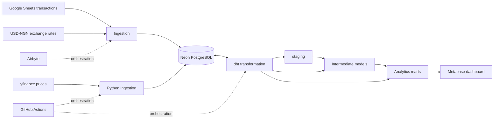

# PortfolioPulse
### A Global Investment Analytics Platform | Datafrik Capstone

PortfolioPulse is a data engineering and analytics project that brings stock transaction history, historical market prices, and USD–NGN exchange rates into a unified workflow to answer:
*What is my investment portfolio worth in USD and Nigerian Naira over time?*

The platform integrates transaction records from Google Sheets, market prices from yfinance, and exchange-rate data into Neon PostgreSQL. Airbyte and custom Python ingestion code handle data collection, dbt Core standardizes and transforms the data into analytics-ready models, GitHub Actions automates configured workflows, and Metabase presents portfolio performance through an interactive dashboard.


> **Project note:** This is a capstone analytics project, not investment advice or a live brokerage statement. Identify any simulated transaction data as simulated.

## Dashboard preview

<div align="center">
    
</div>

The dashboard currently presents portfolio value in USD and NGN, historical market-value trend, position-level gain/loss, ticker allocation, daily movement, unrealized ROI, and top stock by ROI.

## Architecture



### Architecture overview

1. **Source systems:** Provide transaction records, stock market prices, and exchange-rate data.
2. **Ingestion:** Airbyte handles configured source integrations, while custom Python code retrieves historical and recent market prices.
3. **Data storage:** Neon PostgreSQL stores ingested data and supports downstream transformations.
4. **Transformation:** dbt staging views standardize fields and convert data types. Intermediate models and marts prepare the data for analysis.
5. **Orchestration:** GitHub Actions runs the configured automation workflow; Airbyte manages its configured data synchronization.
6. **Visualization:** Metabase connects to the analytics models to display portfolio metrics.


## Technology Stack

| Area | Technology |
|---|---|
| Transaction source | Google Sheets |
| Market-price source | yfinance |
| Exchange-rate source | USD–NGN exchange-rate API |
| Ingestion | Airbyte and Python |
| Database | Neon PostgreSQL |
| Transformation and testing | dbt Core |
| Workflow automation | GitHub Actions and Airbyte scheduling |
| Dashboard | Metabase |
| Local deployment | Docker |


## Data model

The project uses staging, intermediate, and mart models to separate source preparation from business logic and dashboard calculations.

| Layer / model | Grain | Purpose |
|---|---|---|
| `stg_stock_transactions` | One row per trade | Standardized buys and sells |
| `stg_yfinance_prices` | One row per ticker and market date | Historical/current stock prices |
| `stg_exchange_rates` | One row per source rate record | Standardized FX rates |
| `int_transaction_summary` | One row per ticker | Buy/sell totals and holdings summary |
| `mart_portfolio_value_over_time` | One row per date | Historical portfolio market value |
| `mart_profit_loss` | One row per ticker | Current position value, cost basis, unrealized P/L and ROI |
| `mart_daily_portfolio` | One row per valuation date | Daily valuation comparison as defined by the model |
| `mart_current_portfolio_value` | One portfolio-level row | Current USD and NGN value |

Current tracked tickers: `AAPL`, `MSFT`, `AMZN`, `GOOGL`, `JPM`, `JNJ`, `XOM`, and `WMT`.
<div align="center">
    
</div>

## Data Standardization and Quality

The staging layer prepares raw source data before downstream analysis.
For stock transactions, the staging model applies:

- **Whitespace removal:** TRIM() standardizes text fields.
- **Ticker normalization:** UPPER() converts ticker symbols to uppercase.
- **Transaction-type normalization:** INITCAP() standardizes capitalization.
- **Data type conversion:** trade dates are converted to DATE; share quantities, transaction prices, and FX rates are cast to fixed-precision NUMERIC types.
- **Column standardization:** source fields are renamed to consistent analytical names.
- **Transaction filtering:** the model retains records classified as buys or sells.

The project also defines dbt schema tests for selected non-null and uniqueness expectations across staging and mart models.

See [data-quality documentation](/docs/data_quality.md) for the implemented transformations, configured tests, limitations, and additional validation checks.

## Metric definitions

- **Current market value (USD):** Active shares multiplied by the selected latest market price, summed across positions.
- **Current market value (NGN):** USD market value converted using the selected applicable USD–NGN rate.
- **Historical portfolio value:** Holdings accumulated through each market date multiplied by each ticker's market price on that date.
- **Unrealized P/L:** Current market value of active shares minus the cost basis allocated to those shares.
- **Unrealized ROI (%):** Unrealized P/L divided by the active shares' cost basis, multiplied by 100.
- **Net cash invested:** Total buy costs minus sale proceeds. This is a cash-flow metric, not the cost basis of shares still held.
- **Allocation:** Number of shares per individual stock bought


## Running the Project

Prerequisites include Python and its project dependencies, access to the configured Neon PostgreSQL database, dbt Core, and the required source credentials.
After configuring the local dbt profile and project [dependencies](/docs/dependencies.md), run:

```bash
dbt debug
dbt deps
dbt build
```
- `dbt debug` checks the dbt connection and configuration
- `dbt deps` installs packages declared by the project
- `dbt build` builds selected project resources and executes thier applicable tests.


Exact setup depends on the committed `dbt_project.yml`, package configuration, and workflow. Never commit passwords, API keys, private service-account files, or `profiles.yml`.


## Project Deliverables

1. GitHub repo 
2. [Google Drive folder](https://drive.google.com/file/d/1qhYx-EfkAZowrs3brlQP6zmvMHizEZ33/view?usp=drive_link) consisting of the following:
    - ER diagram
    - Design decisions
    - Dashboard screenshots
3. A 3-5mins short video  explaining the project uploaded to drive
4. A read only credential for the database.


## Limitations

- External price and FX data can be missing, delayed, or revised.
- Historical valuation depends on date alignment between trades, market prices, and FX rates.
- Current value, unrealized P/L, realized P/L, and net cash invested are distinct metrics.
- Dashboard values should not be interpreted as financial advice.
- github action lags, automations are delayed. A faster tool is recommended.


## Recommendations & Future Roadmap 
- **Dynamic Scraping Pipeline:** Modify the Python execution code to dynamically query the live staging layer for active tickers (SELECT DISTINCT ticker) rather than using a hardcoded array string. This will allow the pipeline to automatically capture, scale, and fetch historical market data for any new stock added to the Excel transaction sheets. 
- **Realized Gains Ledger:** Construct a dedicated analytical model to isolate and calculate the exact cash profits locked in from the 20 historical sales executed providing visibility into cash generation alongside active market exposure. 
- **Currency Shielding Index:** Create a custom metrics component tracking the financial benefit of holding foreign equities as a hedge against the severe depreciation of the local Naira fiat currency over time. 

## Author

**Isaac Uko Inyang** · Data Engineering & Analytics

- GitHub: [Isaac-Inyang](https://github.com/Isaac-Inyang)
- LinkedIn: [Isaac Uko Inyang](https://www.linkedin.com/in/isaacukoinyang/)

*Built as a Datafrik capstone project.*
